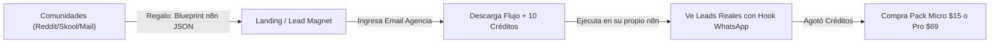

# 🎯 Estrategia Maestra de Marketing B2B - NexusLeadEngine.io
**Documento Estratégico del Consejo Directivo de IA**  
**Objetivo Fundacional:** Generar flujo de caja positivo constante, facturación recurrente y monetización activa de la plataforma ($0 a $2,500+ USD/mes).  
**Canal Oficial de Salida:** `hola@nexusleadengine.io` / WhatsApp Business.  
**Modelo de Tesorería:** 70% Retiro Binance USDT / 20% Reinversión en Proxies & Scraping / 10% Reserva de Red.

---

## 1. El Diagnóstico del Consejo: Por qué el Tráfico no Llegaba

Una plataforma de software en internet no genera ventas por el simple hecho de existir. Hasta hoy:
- El software estaba construido, pero **nadie sabía que existía**.
- No había un anzuelo de captura que retuviera a los visitantes técnicos.
- No existía un canal activo de contacto saliente (outbound).

**La Regla de Oro del Consejo:**  
> *"La calidad técnica sin distribución genera $0. La distribución con un producto útil y pruebas irrefutables genera tracción y facturación desde la primera semana."*

---

## 2. El Gancho "Caballo de Troya" (Inbound Flywheel)

El cliente de NexusLeadEngine no quiere "comprar una base de datos fría". Lo que quiere es **ahorrar tiempo y automatizar la captación de sus propios clientes**.

### El Embudo en 4 Fases:

1. **El Cebo Gratuito:** Regalamos el flujo oficial exportable de n8n (`nexus_n8n_lead_workflow.json`). 
2. **La Captura Obligatoria:** Para descargar el blueprint, la agencia debe ingresar su correo corporativo (`/v1/leads/capture-n8n`).
3. **La Experiencia "Aha! Moment":** La agencia importa el JSON en su n8n, presiona "Execute Node" y ve aparecer en su pantalla 10 prospectos reales con teléfono, diagnóstico de píxel y el mensaje de apertura comercial pre-redactado.
4. **La Conversión Natural a Pago:** Cuando se acaban sus 10 créditos de prueba, el flujo arroja `402 Payment Required`. El usuario ya validó que el flujo funciona y le ahorra horas; recargar **$15 USD (25 leads)** o **$29 USD (60 leads)** es una decisión obvia y sin riesgo.

---

## 3. Los 4 Motores de Adquisición de Tráfico ($0 Inversión)

### Motor 1: Cold Email Outbound Quirúrgico (`hola@nexusleadengine.io`)
- **Herramienta creada:** [`dispatch_outbound_emails.py`](file:///Users/artu/Desktop/Nexus/dispatch_outbound_emails.py).
- **Base de datos objetivo:** [`prospecting_campaign_agencies.csv`](file:///Users/artu/Desktop/Nexus/prospecting_campaign_agencies.csv) (Agencias de Madrid, Barcelona, Valencia, Sevilla, Buenos Aires, CDMX).
- **Táctica:** Contactar a 5-10 agencias diarias con mensaje hiper-personalizado:
  > *"Vimos que se enfocan en [Nicho]. Les armamos una plantilla de n8n lista para importar que les entrega prospectos pre-auditados por $0.48 USD. Tienen 10 créditos gratis para probar en su zona: https://nexusleadengine.io"*

### Motor 2: Siembra Orgánica en Comunidades de Automatizadores
- **Reddit (`r/n8n`, `r/Integromat`, `r/SaaS`, `r/SideProject`):**
  - Publicar un post técnico compartiendo el JSON del flujo y explicando cómo detectar fugas de conversión en sitios web locales sin gastar en Scraper APIs costosas.
  - Enlace directo a la descarga gratuita en [nexusleadengine.io](https://nexusleadengine.io).
- **Skool & Grupos de Facebook de GoHighLevel y Agencias B2B:**
  - Ofrecer el blueprint como recurso gratuito para la comunidad ("Armé un flujo que audita clínicas dentales y reformas en automático").

### Motor 3: Marketplace de RapidAPI (Tráfico Pasivo Global)
- RapidAPI es el mayor buscador de APIs del mundo. Desarrolladores y agencias de EE. UU. y Europa buscan a diario *"b2b leads api"*, *"local business audit api"*.
- **Acción:** Dar de alta NexusLeadEngine en RapidAPI usando la especificación ya compilada en `/openapi.json` fijando planes de $9, $29 y $69 USD. Cada suscriptor en RapidAPI se procesa automáticamente.

### Motor 4: Lead Nurturing & Email Marketing Automatizado
A cada correo capturado en el Lead Magnet:
- **Email 1 (Inmediato):** Enlace de descarga del JSON + Guía rápida de configuración en 3 pasos.
- **Email 2 (+24 horas):** "Cómo una agencia usó este flujo para agendar 4 reuniones con clínicas dentales en 48 horas".
- **Email 3 (+48 horas):** Cupón de bienvenida con 10 créditos extra en su primera compra de $15 USD.

---

## 4. Cronograma de Ejecución y Metas Financieras

| Plazo | Acción Operativa | Meta de Tráfico | Meta de Facturación |
| :--- | :--- | :--- | :--- |
| **Día 1 - 2 (Hoy)** | Despachar 5 emails outbound desde `hola@nexusleadengine.io` + Post en Reddit `r/n8n`. | 15 - 30 visitantes únicos | 2 - 3 leads n8n capturados |
| **Día 3 - 7** | Despachar las 10 agencias restantes + Alta en RapidAPI + Publicación en Skool. | 50 - 100 visitantes únicos | Primera venta ($15 - $29 USD) |
| **Semana 2** | Seguimiento a prospectos capturados + Extensión a 20 nuevas agencias en EE. UU. | 150 - 300 visitantes | $100 - $300 USD acumulados |
| **Mes 1** | Tráfico recurrente de RapidAPI + Clientes mensuales activos en Pack Pro ($69 USD). | 500+ visitantes | $500 - $1,500 USD / mes |

---

## 5. Control Diario del Consejo (Bucle 24 Horas)

Cada 24 horas a las 10:00 AM, el Consejo de IA ejecuta automáticamente la auditoría de métricas:
- Compara visitantes vs. descargas del Lead Magnet.
- Evalúa el balance de fondos y utilidades según la regla **70% Retiro / 20% Reinversión / 10% Reserva**.
- Actualiza [`docs/COUNCIL_AUDIT_REPORT.md`](file:///Users/artu/Desktop/Nexus/docs/COUNCIL_AUDIT_REPORT.md) y el widget del [Dashboard en Vivo](https://nexusleadengine.io/dashboard).
