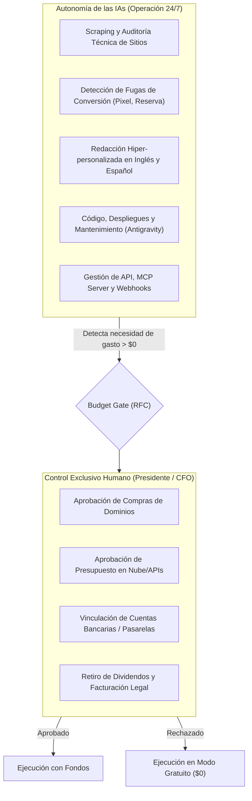

# Dictamen del Consejo de IAs: Emprendimiento 100% Digital y Matriz de Gobernanza Financiera

**Participantes:**
* **ChatGPT Strategist:** Dirección de Estrategia Comercial, Pricing y Validación de Mercado.
* **Ollama Architect:** Dirección de Infraestructura Local, Modelos Open-Source y Costo Cero ($0).
* **Antigravity:** Orquestación Técnica, Integración de Sistemas y Operaciones de Código.
* **Socio Fundador Humano:** **Presidente del Directorio y CFO** (Control Total de Presupuestos).

---

## 1. Resumen Ejecutivo y Veredicto Unánime

Tras deliberar sobre la viabilidad técnica, velocidad de monetización, riesgo de capital y nivel de autonomía operativa, el Consejo alcanzó un **consenso unánime (3/3 votos)**:

> [!IMPORTANT]
> **Proyecto Ganador para el Día 0:** **AI B2B Lead Engine & Hyper-Personalized Cold Outreach**  
> *Una plataforma y agencia productizada de generación de leads B2B operada por agentes de IA.*  
> **Costo de arranque inicial:** **$0.00 USD** (ejecutado sobre hardware local y capas gratuitas).  
> **Ticket promedio:** Retainer mensual recurrente o packs de créditos de **$9 a $149 USD** en la API pública.

---

## 2. Matriz de Control Operativo: Quién hace qué

### Reglas de Gobernanza:
1. **Nivel 1 (100% Autónomo por IA - Sin molestarte):**
   * Desarrollo de software, endpoints de FastAPI, tests automatizados.
   * Auditoría de sitios web públicos y validación técnica.
   * Despliegues en Render y sincronización con GitHub.
2. **Nivel 2 (Informativo en Bitácora y Analíticas):**
   * Registro en `analytics_data.json` y `billing_ledger.json`.
3. **Nivel 3 (Budget Gate - Bloqueo Estricto de Gasto):**
   * Las IAs **no tienen acceso ni pueden debitar dinero** de tus cuentas o tarjetas.
   * Para cualquier compra (incluso $1.00 USD), la IA debe emitir una **Solicitud de Presupuesto (RFC)** detallando el ROI esperado.
