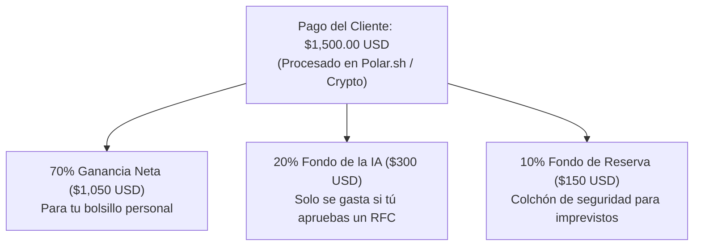

# Manual Operativo y Bitácora Oficial: Nexus Lead Engine

**Fecha de Constitución:** 12 de Octubre de 2026  
**Empresa:** Nexus Lead Engine  
**Socio Fundador & CFO (Presidente):** Tú (Control 100% Presupuestario y de Fondos)  
**Equipo Operativo Autónomo:** ChatGPT Strategist, Ollama Architect & Antigravity  

---

## 1. Identidad y Canal Oficial de Facturación

* **Nombre Oficial:** **Nexus Lead Engine**
* **Significado:** *El motor inteligente que conecta empresas B2B con clientes calificados.*
* **Sitio Web Oficial:** [https://nexusleadengine.io](https://nexusleadengine.io)
* **Canal Oficial de Cobro:** Polar.sh (Merchant of Record / Stripe Connect Express) y Crypto (Binance)
* **Logo Corporativo:** Icono circular de alta tecnología con la "N" estilizada y red de datos en azul eléctrico y cian.
* **Ubicación del Código:** [`/Users/artu/Desktop/Nexus`](file:///Users/artu/Desktop/Nexus)

---

## 2. Política Financiera Blindada para el CFO



> [!IMPORTANT]
> **Regla de Costo Cero ($0.00):** Las IAs nunca pueden gastar fondos sin emitir una solicitud formal de presupuesto (**RFC**). Si decides rechazar una solicitud, el sistema continúa funcionando 100% gratis en el plan alternativo.

---

## 3. Cartera de Empresas Reales en Estados Unidos (Pipeline Activo)

| # | Empresa | Ubicación | Especialidad | Estado en Pipeline |
|---|---|---|---|---|
| **1** | **Plego Technologies** | Chicago, IL | Software & Web Empresarial | 🟢 En seguimiento activo |
| **2** | **AppMakers USA** | Los Ángeles, CA | Apps Móviles iOS/Android ($40k+) | 🟢 En seguimiento activo |
| **3** | **Atomic Object** | Chicago & Michigan | Consultoría de Software (+80 devs) | 🟢 En seguimiento activo |
| **4** | **Goji Labs** | Los Ángeles, CA | Productos Digitales & HealthTech | 🟢 En seguimiento activo |
| **5** | **Kingsmen Digital Ventures** | California | Venture Studio & Co-Builds | 🟢 En seguimiento activo |
| **6** | **Praxent** | Austin, TX | Software Fintech & Bancario | 🟡 En cola de expansión |
| **7** | **BairesDev US** | San Francisco, CA | Staffing & Arquitectura Cloud | 🟡 En cola de expansión |
| **8** | **DevSquad** | Salt Lake City, UT | SaaS Enterprise & MVPs | 🟡 En cola de expansión |
| **9** | **Very Technology** | Boston, MA | IoT & Machine Learning | 🟡 En cola de expansión |
| **10**| **Simform** | Orlando, FL | AWS Premier Partner & Cloud | 🟡 En cola de expansión |

---

## 4. Comandos de Control para el Terminal en Nexus

Puedes ejecutar cualquiera de estos comandos directamente en esta carpeta:

* **Iniciar el Servidor API Local:**
  ```bash
  python3 -m uvicorn api.main:app --reload --port 8000
  ```
* **Probar Integración de Cobros (Polar & Crypto):**
  ```bash
  python3 test_polar.py
  python3 test_nowpayments.py
  ```
* **Ejecutar el Servidor MCP (Model Context Protocol):**
  ```bash
  python3 mcp_server.py
  ```
* **Ver Métricas de Tráfico y Auditorías:**
  ```bash
  python3 -c "import json; print(json.load(open('analytics_data.json')))"
  ```
